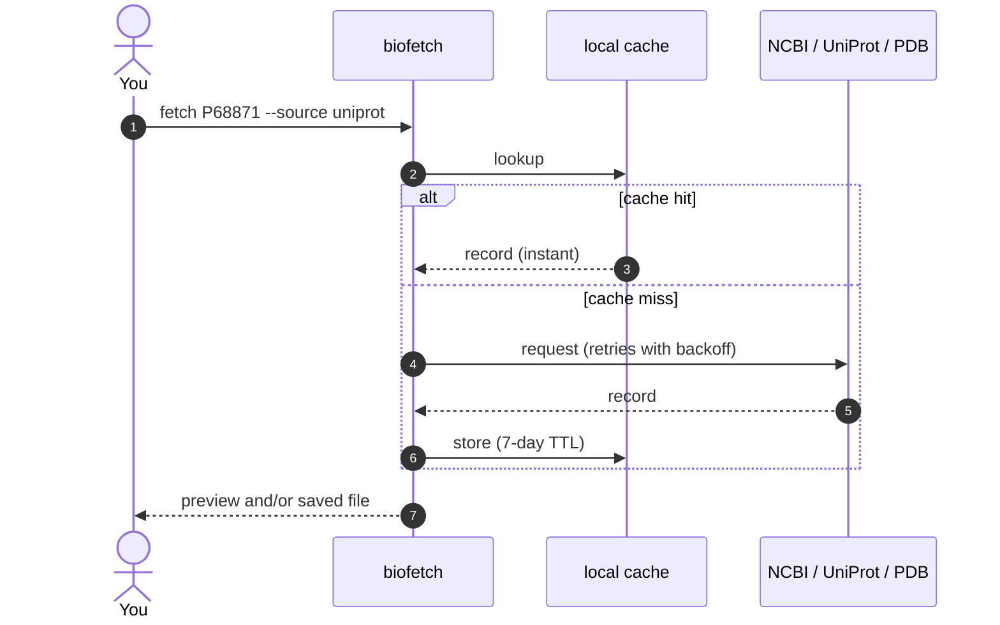
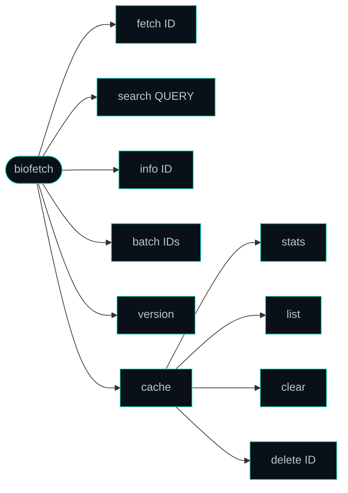
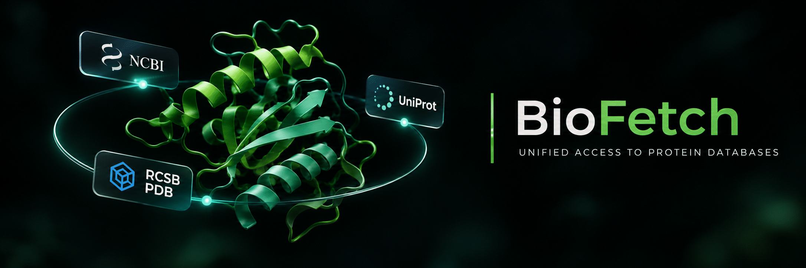

<a id="readme-top"></a>

<div align="center">

<!-- visual slot: banner (assets/banner-animated.gif is ready for this) -->

# biofetch

**One command. Three databases. Zero repeat API calls.**

Unified NCBI · UniProt · PDB CLI fetcher with local caching.

[](https://pypi.org/project/biofetch-cli/)
[](https://www.python.org/)
[](LICENSE)
[](https://github.com/Eswar-mse/biofetch/actions)
[](https://github.com/Eswar-mse/biofetch/commits/main)

[](https://github.com/Eswar-mse/biofetch/stargazers)
[](https://github.com/Eswar-mse/biofetch/network/members)
[](https://github.com/Eswar-mse/biofetch/issues)
[](https://pypi.org/project/biofetch-cli/)
[](CONTRIBUTING.md)


<!-- visual slot: stat strip (3 databases, 7 formats, 7-day cache, pure pip) -->

[**Features**](#features) · [**Install**](#install) · [**Quick start**](#quick-start) · [**How it works**](#how-it-works) · [**Reference**](#reference) · [**FAQ**](#faq) · [**Cite**](#citation)

</div>

> [!NOTE]
> BioFetch needs **Python 3.10 or newer** and runs on Windows, Linux and macOS.

<details>
<summary><b>Table of contents</b></summary>

- [What is BioFetch?](#what-is-biofetch)
- [Features](#features)
- [Install](#install)
- [Quick start](#quick-start)
- [How it works](#how-it-works)
- [Reference](#reference)
  - [Command map](#command-map)
  - [Options](#options)
- [Cache](#cache)
- [FAQ](#faq)
- [Project status](#project-status)
- [Contributing](#contributing)
- [Citation](#citation)
- [Author](#author)
- [License](#license)

</details>

<!-- visual slot: demo (animated terminal walkthrough) -->

---

<a id="what-is-biofetch"></a>

## :dna: What is BioFetch?

BioFetch is a cross-platform Python CLI that searches, fetches and saves records from **NCBI**, **UniProt** and **RCSB PDB**, all from your terminal. It remembers what it has already pulled, so you stop re-downloading the same FASTA.

```diff
- curl "https://rest.uniprot.org/uniprotkb/P68871.fasta"   # again next week, and again next month
+ biofetch fetch P68871 --source uniprot                     # once. Then it's cached.
```

<p align="right"><a href="#readme-top">back to top ↑</a></p>

---

<a id="features"></a>

## :sparkles: Features

| Command | What it does |
| :--- | :--- |
| :inbox_tray: **`fetch`** | Grab one record by accession from NCBI, UniProt or PDB. Preview it in the terminal or save it to disk. |
| :mag: **`search`** | Search any of the three databases and get a ranked results table. Filter UniProt to reviewed entries with `--reviewed`.[^reviewed] |
| :information_source: **`info`** | A rich metadata summary panel without downloading the full file. |
| :package: **`batch`** | Fetch many accessions in one command. Each record is saved as its own file, with live progress. |
| :floppy_disk: **`cache`** | Responses are stored on disk with a 7-day TTL, so repeat lookups are instant and kind to the APIs. |
| :page_facing_up: **7 formats** | FASTA, GenBank, JSON, XML, PDB, mmCIF and TSV. |

Also: automatic retries with backoff when an API hiccups, a [Rich](https://github.com/Textualize/rich) terminal UI, and pure `pip`. No conda, no virtual environment drama.

**Databases at a glance**

| Database | Identifier | Example | Good to know |
| :--- | :--- | :--- | :--- |
| **NCBI** (Entrez) | Accession | `NM_001301717` | Pick a database with `--db`: `nucleotide`, `protein`, `gene` or `pubmed` |
| **UniProt** (REST) | Accession | `P68871` | `--reviewed` limits search to Swiss-Prot entries |
| **RCSB PDB** | 4-character ID | `1HHO` | Save structures as `pdb` or `cif` |

<!-- visual slot: feature cards -->

<p align="right"><a href="#readme-top">back to top ↑</a></p>

---

<a id="install"></a>

## :package: Install

```bash
pip install biofetch-cli
```

> [!TIP]
> Prefer an isolated install? `pipx install biofetch-cli` keeps BioFetch and its dependencies out of your global environment.

<details>
<summary><b>Install from source</b></summary>

```bash
git clone https://github.com/Eswar-mse/biofetch.git
cd biofetch
pip install -e .
```

</details>

Check it worked:

```bash
biofetch version
```

<p align="right"><a href="#readme-top">back to top ↑</a></p>

---

<a id="quick-start"></a>

## :rocket: Quick start

```bash
# 1. find something
biofetch search "hemoglobin" --source uniprot --reviewed --limit 5

# 2. fetch it, with the metadata panel
biofetch fetch P68871 --source uniprot --info

# 3. run it again: served from cache, instantly
biofetch fetch P68871 --source uniprot
```

> [!TIP]
> Compare the status line of step 2 and step 3. The first says the record was fetched and cached, the second says it was served from cache.

<details>
<summary><b>More recipes</b></summary>

```bash
# Fetch a nucleotide sequence from NCBI
biofetch fetch NM_001301717 --source ncbi

# Fetch a PDB structure as a .pdb file
biofetch fetch 1HHO --source pdb --format pdb --output 1HHO.pdb

# Search the NCBI nucleotide database
biofetch search "BRCA1 human mRNA" --source ncbi --db nucleotide --limit 10

# Search PDB for insulin structures
biofetch search "insulin" --source pdb --limit 5

# Rich metadata for a UniProt entry
biofetch info P68871 --source uniprot

# PDB entry summary
biofetch info 1HHO --source pdb

# Batch fetch several UniProt accessions
biofetch batch P68871 P69905 P68873 --source uniprot --outdir ./sequences

# Batch fetch NCBI records
biofetch batch NM_001301717 NM_000546 --source ncbi --db nucleotide --outdir ./data
```

</details>

<p align="right"><a href="#readme-top">back to top ↑</a></p>

---

<a id="how-it-works"></a>

## :microscope: How it works

Every request is checked against the local cache first. Only a miss touches the network, and the result is stored for next time.


A cached record counts as a hit while $t_{now} - t_{fetch} < 7\ \text{days}$.[^ttl] Add `--no-cache` whenever you want a fresh pull, which skips the cache check and goes straight to the API.

<details>
<summary><b>Sequence view</b></summary>



</details>

<!-- visual slot: how-it-works flow diagram (optional designed version of the diagram above) -->

<p align="right"><a href="#readme-top">back to top ↑</a></p>

---

<a id="reference"></a>

## :books: Reference

<a id="command-map"></a>

### Command map



| Command | What it does |
| :--- | :--- |
| `biofetch fetch <ID>` | Fetch a single record |
| `biofetch search <query>` | Search a database |
| `biofetch info <ID>` | Show a metadata summary |
| `biofetch batch <IDs...>` | Batch fetch and save |
| `biofetch cache stats` | Show cache size and entry count |
| `biofetch cache list` | List all cached keys |
| `biofetch cache clear` | Clear the entire cache |
| `biofetch cache delete <ID> --source <source>` | Remove one cached entry |
| `biofetch version` | Print the version |

<!-- visual slot: command cheat sheet -->

<a id="options"></a>

### Options

<details>
<summary><b><code>fetch</code> options</b></summary>

| Flag | Description |
| :--- | :--- |
| `--source` / `-s` | `ncbi`, `uniprot` or `pdb` |
| `--format` / `-f` | `fasta`, `genbank`, `json`, `xml`, `pdb`, `cif`, `tsv` |
| `--db` | NCBI database: `nucleotide`, `protein`, `gene`, `pubmed` |
| `--output` / `-o` | Save to a file path |
| `--info` / `-i` | Show the metadata panel |
| `--no-preview` | Skip the terminal sequence preview |
| `--no-cache` | Force a fresh API request |

</details>

<details>
<summary><b><code>search</code> options</b></summary>

| Flag | Description | Default |
| :--- | :--- | :--- |
| `--source` / `-s` | `ncbi`, `uniprot` or `pdb` | `ncbi` |
| `--db` | NCBI database: `nucleotide`, `protein`, `gene`, `pubmed` | `nucleotide` |
| `--limit` / `-n` | Maximum results to return | `10` |
| `--reviewed` | UniProt only: Swiss-Prot reviewed entries | off |

</details>

<details>
<summary><b><code>batch</code> and <code>info</code> options</b></summary>

`biofetch batch`

| Flag | Description | Default |
| :--- | :--- | :--- |
| `--source` / `-s` | `ncbi`, `uniprot` or `pdb` (required) | none |
| `--format` / `-f` | Output format | `fasta` |
| `--db` | NCBI database | `nucleotide` |
| `--outdir` / `-d` | Directory to save files in | `.` |
| `--no-cache` | Bypass the cache | off |

`biofetch info`

| Flag | Description | Default |
| :--- | :--- | :--- |
| `--source` / `-s` | `ncbi`, `uniprot` or `pdb` (required) | none |
| `--db` | NCBI database | `nucleotide` |

</details>

<details>
<summary><b><code>cache</code> options</b></summary>

`biofetch cache clear`

| Flag | Description | Default |
| :--- | :--- | :--- |
| `--force` / `-f` | Skip the confirmation prompt | off |

`biofetch cache delete <ID>`

| Flag | Description | Default |
| :--- | :--- | :--- |
| `--source` / `-s` | `ncbi`, `uniprot` or `pdb` (required) | none |
| `--format` / `-f` | Format of the cached entry to remove | `fasta` |

</details>

<details>
<summary><b>Dependencies</b></summary>

| Package | Purpose |
| :--- | :--- |
| `biopython` | NCBI Entrez and sequence parsing |
| `requests` | UniProt and PDB REST APIs |
| `diskcache` | Local disk-based caching |
| `rich` | Terminal formatting and tables |
| `typer` | CLI framework |

All installable with `pip`. No conda, no virtual environment required.

</details>

<p align="right"><a href="#readme-top">back to top ↑</a></p>

---

<a id="cache"></a>

## :floppy_disk: Cache

BioFetch caches every response locally:

| OS | Location |
| :--- | :--- |
| **Windows** | `%LOCALAPPDATA%\biofetch\` |
| **Linux / macOS** | `~/.cache/biofetch/` |

> [!IMPORTANT]
> Cached records are served for up to **7 days**. If a record changes upstream in that window you will not see the change until you pass `--no-cache` or remove the entry with `biofetch cache delete`.

> [!WARNING]
> `biofetch cache clear` deletes **every** cached record. It asks for confirmation first, unless you pass `--force`.

> [!CAUTION]
> NCBI, UniProt and RCSB PDB are free public services. Avoid hammering them in tight loops with `--no-cache`. Let the cache do its job.

<p align="right"><a href="#readme-top">back to top ↑</a></p>

---

<a id="faq"></a>

## :question: FAQ

<details>
<summary><b>How do I get a fresh copy of a record?</b></summary>

Pass `--no-cache` to bypass the cache for one call, or remove the stored entry:

```bash
biofetch cache delete P68871 --source uniprot
```

</details>

<details>
<summary><b>Can I save results to a file?</b></summary>

Yes. Use `--output` with `fetch` for a single file, or `--outdir` with `batch` to save every record into a folder.

</details>

<details>
<summary><b>How do I stop a long batch?</b></summary>

Press <kbd>Ctrl</kbd> + <kbd>C</kbd>. Anything already fetched stays in the cache, so running the batch again picks up quickly.

</details>

<details>
<summary><b>Do I need conda?</b></summary>

You do not need conda. BioFetch installs with plain `pip`.

</details>

<details>
<summary><b>Which Python versions and operating systems are supported?</b></summary>

Python 3.10 or newer on Windows, Linux and macOS.

</details>

<p align="right"><a href="#readme-top">back to top ↑</a></p>

---

<a id="project-status"></a>

## :white_check_mark: Project status

- [x] `fetch`, `search`, `info` and `batch` across NCBI, UniProt and PDB
- [x] Local disk cache with a 7-day TTL
- [x] Seven output formats
- [x] Automatic retries with backoff
- [x] Published on [PyPI](https://pypi.org/project/biofetch-cli/)
- [ ] Automated tests in CI (in progress)
- [ ] Changelog and tagged releases (in progress)

<p align="right"><a href="#readme-top">back to top ↑</a></p>

---

<a id="contributing"></a>

## :handshake: Contributing

Found a bug or have an idea? [Open an issue](https://github.com/Eswar-mse/biofetch/issues). Pull requests are welcome, see [CONTRIBUTING.md](CONTRIBUTING.md) first.

> [!TIP]
> New to the codebase? Run `biofetch --help` to see every command, then read the matching module in the `biofetch/` package.

<!-- visual slot: contributors wall -->
<!-- visual slot: star history chart -->

<p align="right"><a href="#readme-top">back to top ↑</a></p>

---

<a id="citation"></a>

## :scroll: Citation

If BioFetch helps your research, please cite it:

<div align="center">
  
</div>


```bibtex
@software{moparti_biofetch,
  author  = {Moparti, Sri Venkata Satya Sai Eswar},
  title   = {BioFetch: unified NCBI, UniProt and PDB command-line fetcher with local caching},
  year    = {2026},
  url     = {https://github.com/Eswar-mse/biofetch},
  version = {1.0.2}
}
```

<p align="right"><a href="#readme-top">back to top ↑</a></p>

---

<a id="author"></a>

## :bust_in_silhouette: Author

**Sri Venkata Satya Sai Eswar Moparti**, author and maintainer of biofetch.

[Portfolio](https://eswar-mse.github.io) · [ORCID 0009-0005-4635-7368](https://orcid.org/0009-0005-4635-7368) · [GitHub @Eswar-mse](https://github.com/Eswar-mse)

If BioFetch saves you time, a :star: on GitHub helps other researchers find it.

<!-- visual slot: author card -->

<a id="license"></a>

## :balance_scale: License

Released under the [MIT license](LICENSE).

<!-- visual slot: footer strip -->

<p align="right"><a href="#readme-top">back to top ↑</a></p>

[^reviewed]: "Reviewed" means UniProtKB/Swiss-Prot, the manually annotated and curated part of UniProt.
[^ttl]: Entries are stored through [`diskcache`](https://grantjenks.com/docs/diskcache/) with a 7-day expiry.
