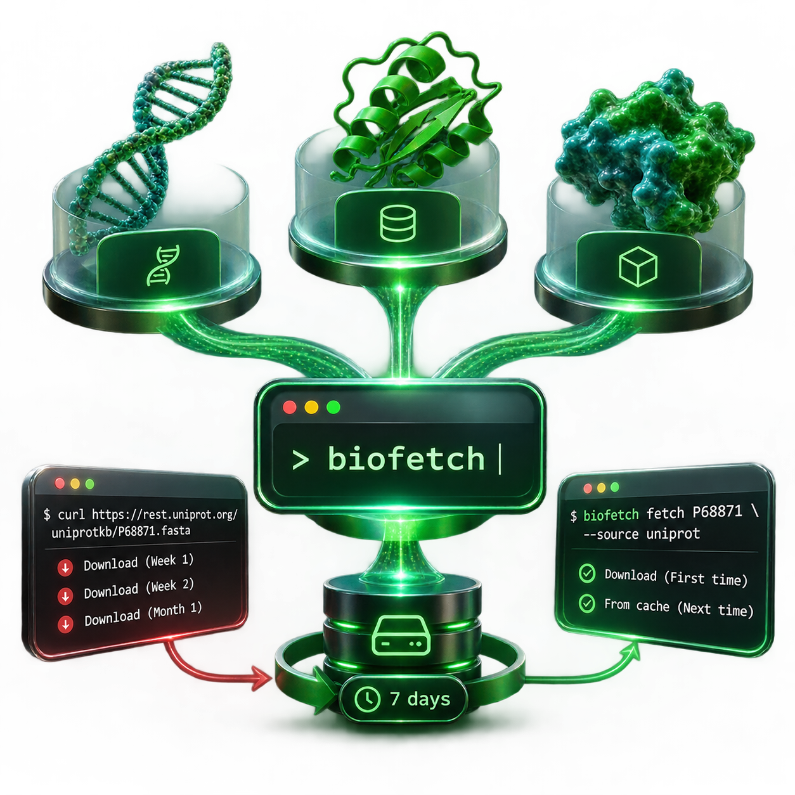

<div align="center">

<!-- visual slot: banner -->

<div align="center">
   
</div> 
<div>&nbsp;
</div> 
</div> 

 
</div> 

 


<p align="center">
  <a href="https://pypi.org/project/biofetch-cli/"></a>
  <a href="https://www.python.org/"></a>
  <a href="LICENSE"></a>
  <a href="https://github.com/Eswar-mse/biofetch/actions"></a>
  <a href="https://github.com/Eswar-mse/biofetch/commits/main"></a>
  <a href="https://github.com/Eswar-mse/biofetch/stargazers"></a>
  <a href="https://github.com/Eswar-mse/biofetch/network/members"></a>
  <a href="https://github.com/Eswar-mse/biofetch/issues"></a>
  
  
</p>


</div>

<div align="center">
<h3>What is BioFetch?</h3>


Biology lives in public databases. **NCBI** holds DNA, RNA and protein sequence records, **UniProt** holds curated information about proteins, and **RCSB PDB** holds 3D structures. Each one has its own web API and its own file formats. BioFetch puts all three behind a single command, `biofetch`, so you can look a record up, read a preview in your terminal, or save it as a file, without opening a browser or learning three APIs. It also remembers what it has already downloaded, so asking for the same record twice costs nothing.

**Under the hood.** BioFetch is a Python command-line tool. [Typer](https://typer.tiangolo.com/) provides the commands and options, [Rich](https://github.com/Textualize/rich) draws the panels and tables, and NCBI is reached through Biopython's Entrez module. UniProt and RCSB PDB are reached through their public REST APIs using `requests`. Every download is stored in a local [diskcache](https://grantjenks.com/docs/diskcache/) database for seven days.
</div>


```diff
- curl "https://rest.uniprot.org/uniprotkb/P68871.fasta"   # again next week, and again next month
+ biofetch fetch P68871 --source uniprot                     # once. Then it's cached.
```


<div align="center">
<h3> Who Is BioFetch For?</h3>
</div>

- **Biologists and students** who need quick access to sequence or structure files without writing code.
- **Bioinformaticians** who want a consistent interface for scripts and pipelines, with fewer repetitive calls to public services.
- **Teachers and demonstrators** who need predictable, readable terminal output for teaching and demonstrations.

**Why BioFetch?** While `curl` is useful for one-off downloads and Biopython offers extensive programmatic control, BioFetch brings access to NCBI, UniProt, and RCSB PDB behind a single, consistent command-line interface. It combines readable terminal previews, file downloads, and local caching to make repeated retrieval simpler and more efficient.


<!-- visual slot: feature cards -->
<div align="center">
<h3>Installation </h3>
</div>

```bash
pip install biofetch-cli
```

> [!NOTE]
> BioFetch needs **Python 3.10 or newer** and an internet connection. Its five dependencies (`biopython`, `requests`, `diskcache`, `rich` and `typer`) install automatically.

**In plain terms.** The package on PyPI is called `biofetch-cli`, but the command you type is `biofetch`. Check that it works:

```bash
biofetch version
biofetch --help
```

**Going deeper.** Install it in isolation with `pipx install biofetch-cli`, upgrade later with `pip install --upgrade biofetch-cli`, or install from source:

```bash
git clone https://github.com/Eswar-mse/biofetch.git
cd biofetch
pip install -e .
```

To uninstall, run `pip uninstall biofetch-cli`. Your cached records stay on disk until you run `biofetch cache clear` or delete the cache folder (see [the cache](#the-cache)). BioFetch is pure Python and is developed on Windows and Linux. Continuous integration runs on Linux with Python 3.10, 3.11 and 3.12, and macOS is expected to work as well.


<div align="center">
<h3> Quick start </h3>
</div>
<!-- visual slot: demo (the one place on this page where height is welcome) -->

Three commands tell the whole story. First, find a protein:

```bash
biofetch search "hemoglobin" --source uniprot --reviewed --limit 5
```

You get a table of up to five UniProt entries with their accession, protein name, gene, organism and length. `--reviewed` keeps only manually curated Swiss-Prot entries.[^reviewed] Pick an accession, for example `P68871` (human hemoglobin subunit beta), and fetch it together with its metadata:

```bash
biofetch fetch P68871 --source uniprot --info
```

BioFetch prints a status line, a preview of the first lines of the FASTA record, and a UniProt Summary panel with the entry name, gene, organism, length, mass, keywords and function. Run the same command once more:

```bash
biofetch fetch P68871 --source uniprot
```

This time the status line says the record was **served from cache**. No network request was made for the sequence.

> [!TIP]
> To keep the whole record rather than a preview, add `--output P68871.fasta`. The terminal shows a preview only, by design, so a huge record never floods your screen.

**More recipes.**

```bash
# Fetch a nucleotide sequence from NCBI
biofetch fetch NM_001301717 --source ncbi

# Fetch a protein record from NCBI (note --db protein)
biofetch fetch NP_000509 --source ncbi --db protein

# Fetch a PDB structure as a .pdb file
biofetch fetch 1HHO --source pdb --format pdb --output 1HHO.pdb

# Search the NCBI nucleotide database
biofetch search "BRCA1 human mRNA" --source ncbi --db nucleotide --limit 10

# Search PDB for insulin structures
biofetch search "insulin" --source pdb --limit 5

# Rich metadata for a UniProt entry, and a PDB entry summary
biofetch info P68871 --source uniprot
biofetch info 1HHO --source pdb

# Batch fetch several UniProt accessions into a folder
biofetch batch P68871 P69905 P68873 --source uniprot --outdir ./sequences

# Batch fetch NCBI records
biofetch batch NM_001301717 NM_000546 --source ncbi --db nucleotide --outdir ./data
```


<div align="center">
<h3>  How it works </h3>
</div>

**In plain terms.** A **cache** is a local copy of an answer, kept so that asking the same question again does not need the internet. A **TTL** (time to live) says how long that copy is trusted before BioFetch asks the database again. BioFetch keeps copies for seven days. Public databases apply rate limits and most records change rarely, so a week-long TTL trades a little freshness for a lot of speed and good manners. **Backoff** means waiting a little longer after each failed attempt, so a busy server or a flaky connection gets time to recover.


**Under the hood.** Step by step, a `fetch` works like this:

1. Typer parses your command and options.
2. BioFetch builds a cache key of the form `source:accession:format`, for example `uniprot:P68871:fasta`, and looks it up in the local cache.
3. On a **hit** the stored text is delivered immediately. On a **miss** the matching module (`ncbi.py`, `uniprot.py` or `pdb.py`) contacts the database.
4. A successful download is stored with an expiry of 604,800 seconds, which is seven days, and then delivered.

A stored record counts as a hit while $t_{now} - t_{fetch} < 7\ \text{days}$.[^ttl]

**Retries.** Record downloads make up to **three attempts**. After the first failure BioFetch waits 1.5 seconds, after the second it waits 3 seconds, and after the third it gives up with an error message. Downloads time out after 15 seconds, or 30 seconds for PDB structure files. Searches and most metadata lookups are single attempts, with PDB entry metadata as the one exception. Because every failure is retried, even a mistyped accession takes a few seconds to be reported.

**Errors.** Any failure is caught and printed as a red `✗` line. For `fetch`, `search` and `info` BioFetch then exits with code `1`, which makes failures easy to detect in scripts. In `batch`, one failing record never stops the others, and failed records are never written to the cache.


<div align="center">
<h3>Commands</h3>

Every command prints a small header panel first, then uses the same four status symbols:


| Symbol | Meaning |
| :--- | :--- |
| <span>✓</span> green | Success, for example a record was fetched, served from cache or cleared |
| <span>✗</span> red | An error. The command exits with code `1` |
| <span>⚠</span> yellow | A warning. The command carries on, for example a metadata lookup failed but the record was still delivered |
| <span>→</span> cyan | Information, for example where a file was saved |

<div>&nbsp;
</div> 

| Command | Purpose | `--source` |
| :--- | :--- | :--- |
| `biofetch fetch <ID>` | Get one record | required |
| `biofetch search <query>` | Find records by keyword | optional, defaults to `ncbi` |
| `biofetch info <ID>` | Show metadata without downloading the sequence | required |
| `biofetch batch <IDs...>` | Fetch many records and save each as a file | required |
| `biofetch cache ...` | Inspect and manage the local cache | `delete` only |
| `biofetch version` | Print the version | none |

<div>&nbsp;
</div> 

### `fetch`: get one record
Downloads a single record by its accession ID and shows you the start of it. Add `--output` to save the whole record to a file.

| Flag | Description | Default |
| :--- | :--- | :--- |
| `--source` / `-s` | `ncbi`, `uniprot` or `pdb` | required |
| `--format` / `-f` | Output format, see [formats per database](#formats-per-database) | `fasta` |
| `--db` | NCBI database: `nucleotide`, `protein`, `gene` or `pubmed` | `nucleotide` |
| `--output` / `-o` | Save the full record to this file | print a preview |
| `--info` / `-i` | Also show a metadata panel | off |
| `--preview` / `--no-preview` | Show or hide the terminal preview | preview on |
| `--no-cache` | Skip the cache read and force a fresh download | off |

`--info` behaves differently per database. For **UniProt** it makes one extra request and shows the UniProt Summary panel. For **PDB** it shows the PDB Entry Summary. For **NCBI** it only works with `--format fasta` and shows a small table with the ID, length and GC percentage of each sequence, computed locally. If the extra lookup fails you get a `⚠` warning and the record is still delivered.

<div>&nbsp;
</div> 

### `search`: find records

Searches one database and lists the best matches, so you can find the accession to fetch.

| Flag | Description | Default |
| :--- | :--- | :--- |
| `--source` / `-s` | `ncbi`, `uniprot` or `pdb` | `ncbi` |
| `--db` | NCBI database: `nucleotide`, `protein`, `gene` or `pubmed` | `nucleotide` |
| `--limit` / `-n` | Maximum number of results | `10` |
| `--reviewed` | UniProt only: Swiss-Prot reviewed entries | off |

<div>&nbsp;
</div> 

### `info`: metadata without the sequence

Shows a tidy summary panel about a record, such as what it is, where it comes from and how big it is, without downloading the sequence itself.

| Database | Panel | Fields |
| :--- | :--- | :--- |
| **UniProt** | UniProt Summary | Accession, entry name, protein name, gene, organism, the last three taxonomy levels, length, mass, Swiss-Prot or TrEMBL status, up to ten keywords, and the first function description (cut at 300 characters) |
| **PDB** | PDB Entry Summary | PDB ID, title, experimental method, resolution in Å, R-free, R-work, polymer chain count and atom count |
| **NCBI** | NCBI Record Info | Every field of NCBI's summary record, with long values cut at 120 characters |

**Under the hood.** `info` always makes live requests and does not use the cache. Only PDB entry metadata is retried on failure.

<div>&nbsp;
</div> 

### `batch`: many records at once

Give it a list of accession IDs and it fetches each one and saves it as its own file in a folder. A live spinner with the accession being processed and the elapsed time, then a **Batch Fetch Results** table with one row per record (`OK` or `Failed`, and its size), and finally `→ Files saved to <folder>`.

| Flag | Description | Default |
| :--- | :--- | :--- |
| `--source` / `-s` | `ncbi`, `uniprot` or `pdb` | required |
| `--format` / `-f` | Output format | `fasta` |
| `--db` | NCBI database | `nucleotide` |
| `--outdir` / `-d` | Folder to save files in (created if missing) | `.` |
| `--no-cache` | Skip the cache read for every record | off |


<div>&nbsp;
</div> 

### `cache`: manage stored records

Four small commands to look after the local copies BioFetch keeps.

| Command | What it prints |
| :--- | :--- |
| `biofetch cache stats` | A Cache Stats panel with the number of cached entries, the cache size in KB or MB, and the cache folder |
| `biofetch cache list` | `N cached entries:` followed by one key per line, such as `uniprot:P68871:fasta` |
| `biofetch cache delete <ID> --source <source>` | `✓ Deleted cache entry: uniprot:P68871:fasta`, or a `⚠` warning if there was no such entry |
| `biofetch cache clear` | A confirmation question, then `✓ Cache cleared.` |

**Under the hood.** `cache delete` needs the same format the record was fetched with and defaults to `fasta`, so for a record fetched as JSON use `--format json`. `cache clear` asks for confirmation unless you pass `--force` / `-f`.
</div>
<div>&nbsp;
</div> 


## :page_facing_up: Formats per database

<a id="formats-per-database"></a>

**In plain terms.** A *format* is how a record is written down. Some formats are just the sequence, others add annotations, and others describe 3D coordinates. The same `--format` flag is shared by all databases, but each database only supports its own set:

| Database | `--format` values | Notes |
| :--- | :--- | :--- |
| **NCBI** | `fasta` (default), `genbank` (or `gb`), `xml`, `text` | `genbank` adds features and annotations to the sequence |
| **UniProt** | `fasta` (default), `json`, `txt`, `xml`, `tsv` | `txt` is UniProt's classic flat-file format, `tsv` suits spreadsheets |
| **RCSB PDB** | `fasta`, `pdb`, `cif` | `fasta` is the default and gives the *sequences* of the entry. For atomic coordinates ask for `pdb` or `cif` |

**Which one should I use?**

- **FASTA** is the plain sequence with a single header line. Choose it for alignments, BLAST and most sequence tools.
- **GenBank** is the sequence plus its annotations, such as genes, coding regions, the source organism and references. Choose it when you need to know what the sequence *contains*.
- **JSON** and **XML** are structured and machine-readable. Choose them when a script or program will read the record.
- **TSV** is a tab-separated table. Choose it to open a UniProt record in a spreadsheet.
- **PDB** and **mmCIF** hold the 3D coordinates of every atom, and tools such as PyMOL and ChimeraX open both. mmCIF is the newer, extensible format, and some very large structures are only available as mmCIF.

> [!WARNING]
> BioFetch does not validate `--format` against the database. An unsupported value quietly falls back instead of failing: NCBI and UniProt return FASTA, and PDB returns mmCIF. The record is then cached under the format name you typed. If something looks wrong, compare your value with the table above.

## :floppy_disk: The cache

<a id="the-cache"></a>

**In plain terms.** The first time you fetch a record, BioFetch keeps a copy in a folder on your computer. Next time it reads that copy instead of using the internet, which is instant and spares the public databases.

**Where it lives.**

| System | Location |
| :--- | :--- |
| **Windows** | `%LOCALAPPDATA%\biofetch\` |
| **Linux and macOS** | `$XDG_CACHE_HOME/biofetch/`, which is `~/.cache/biofetch/` when that variable is not set |

**Under the hood.** The folder is a [diskcache](https://grantjenks.com/docs/diskcache/) database, which is built on SQLite and is designed to be used safely by several processes at once, so running two BioFetch commands in parallel is fine. Each entry is keyed `source:accession:format` and expires after seven days. The expiry is fixed in the current version and is not a command-line option. If the folder is ever damaged, deleting it is safe, because it only holds copies of public data.

> [!IMPORTANT]
> Cached records are served for up to **7 days**. If a record changes upstream in that window, pass `--no-cache` or run `biofetch cache delete` to see the change.

> [!WARNING]
> `biofetch cache clear` deletes **every** cached record. It asks for confirmation first, unless you pass `--force`.

> [!CAUTION]
> NCBI, UniProt and RCSB PDB are free public services. Avoid hammering them in tight loops with `--no-cache`.

## :building_construction: Architecture

**In plain terms.** BioFetch is split into small parts that each do one job: one part reads your command, one part talks to each database, one part remembers answers, and one part draws the output.


**Under the hood.**

```text
biofetch/
├── biofetch/
│   ├── __init__.py    version string
│   ├── cli.py         Typer app: fetch, search, info, batch, cache, version
│   ├── cache.py       diskcache wrapper: folder, keys, 7-day TTL, stats
│   ├── ncbi.py        NCBI Entrez through Biopython
│   ├── uniprot.py     UniProt REST API: records, search, metadata
│   ├── pdb.py         RCSB PDB data, file and search APIs
│   └── display.py     Rich panels, tables, spinners and previews
├── tests.py           34 mocked tests, no network needed
├── CHANGELOG.md
├── pyproject.toml
└── .github/workflows/ci.yml
```

A few design choices keep it easy to read and extend:

- **The database modules never import each other.** Each one takes plain arguments and returns plain strings, lists and dictionaries.
- **The cache lives in `cli.py`, not in the database modules.** The fetchers stay simple, and the CLI decides when a copy is good enough.
- **Display is separate from networking.** `display.py` only knows how to draw data, so the look of the output can change without touching any API code.

**Adding another database** takes four steps: write a module with fetch, search and summary functions, add its name to the `Source` enum in `cli.py` and a branch to `fetch`, `search`, `info` and `batch`, add display helpers for its tables, and add mocked tests.

## :toolbox: Using BioFetch in scripts

**In plain terms.** BioFetch works well inside shell scripts and pipelines, as long as you remember two things: use `--output` to get the full record, and check the exit code.

```bash
# Save one record, and only continue if it worked
biofetch fetch P68871 --source uniprot --output P68871.fasta && echo "saved"

# Fetch every accession listed in a file (one per line)
biofetch batch $(cat accessions.txt) --source uniprot --outdir ./sequences
```

```powershell
# The same batch in PowerShell
biofetch batch (Get-Content accessions.txt) --source uniprot --outdir .\sequences
```

**Under the hood.** `fetch`, `search` and `info` exit with `1` on failure, and a missing required option exits with `2`. `batch` always exits with `0`, so inspect its summary table or the output folder to see which records failed. Re-running a batch is cheap, because everything that succeeded is already cached and only the failures reach the network again. Output is meant for people, with colours and panels, so for programmatic use rely on the saved files instead of parsing the terminal text.

## :lock: Privacy and network

BioFetch has no server, account, API key or telemetry of its own. The only network traffic is between your computer and NCBI, UniProt and RCSB PDB, and what is sent is just the accession or search query you typed. Cached records are plain copies of public data stored in your user cache folder. NCBI is contacted through Biopython and UniProt and PDB through `requests`, so if you work behind a proxy, set the usual `HTTP_PROXY` and `HTTPS_PROXY` environment variables.

## :construction: Limitations

Knowing these up front saves surprises:

- `fetch` prints a **preview** only. Use `--output` to keep the full record.
- The cache lifetime is fixed at **7 days** and cannot be changed from the command line.
- NCBI search shows Entrez IDs only, and PDB search shows IDs and scores only. Use `info` to learn more about a hit.
- Searches and `info` lookups are **not cached**.
- BioFetch uses a generic contact address for NCBI Entrez and does not use an NCBI API key, so NCBI's default request limit of about three requests per second applies.
- `batch` is sequential and has no built-in delay between records. It relies on retries when a service pushes back.
- Only text formats are supported.

## :wrench: Troubleshooting

| What you see | Likely cause | What to do |
| :--- | :--- | :--- |
| `biofetch: command not found`, or `'biofetch' is not recognized` | pip's script folder is not on your `PATH` | Use `pipx install biofetch-cli`, add the scripts folder to `PATH`, or run `python -m biofetch.cli` |
| `✗ UniProt fetch failed for X: 404 Client Error` | The accession does not exist or was retired | Check the ID with `biofetch search`. BioFetch retried three times, which is why it took a few seconds |
| `✗ NCBI fetch failed` or `No data returned for X` | A wrong accession, or the wrong `--db` | Protein accessions such as `NP_000509` need `--db protein`, because the default is `nucleotide` |
| You asked for JSON or GenBank and got something else | That format is not supported by the database | See [formats per database](#formats-per-database). Unsupported values fall back to FASTA, or to mmCIF for PDB |
| A PDB fetch printed a sequence, not coordinates | The default format is `fasta` | Add `--format pdb` or `--format cif` |
| `fetch` printed no sequence | `--no-preview` was used without `--output` | Use `--output FILE`, or drop `--no-preview` |
| A record looks out of date | You are seeing the cached copy | Use `--no-cache`, or `biofetch cache delete <ID> --source <source>` |
| `⚠ Could not fetch metadata` after `--info` | The extra metadata lookup failed | The record itself was delivered. Run `biofetch info` to retry the lookup |
| `Failed` in a batch table | That record failed after three attempts | Run the same command again. Finished records come from the cache, and only the failures are retried |
| The GC % looks odd for a protein | GC percentage is computed for any FASTA | It is only meaningful for nucleotide sequences |
| Slow or stuck commands | A slow network or a busy service | BioFetch times out after 15 seconds (30 for PDB structure files) and retries. Check your connection and proxy settings |
| Symbols such as `✓` look broken | The terminal is not using Unicode | Use a modern terminal such as Windows Terminal |

## :brain: Glossary

| Term | Meaning |
| :--- | :--- |
| **Accession** | A stable identifier for a record, such as `NM_001301717` (NCBI), `P68871` (UniProt) or `1HHO` (PDB) |
| **Entrez** | NCBI's search and retrieval system, used by BioFetch through Biopython |
| **Swiss-Prot and TrEMBL** | The two halves of UniProtKB: manually reviewed entries, and automatically annotated ones |
| **FASTA** | A plain-text sequence format with one header line |
| **GenBank** | A sequence format with annotations such as genes, features and references |
| **PDB and mmCIF** | Formats for 3D structure coordinates. mmCIF is the newer one |
| **TTL** | Time to live: how long a cached copy is trusted before it expires |
| **Backoff** | Waiting longer after each failed attempt before trying again |

## :white_check_mark: Project status

- [x] `fetch`, `search`, `info` and `batch` across NCBI, UniProt and PDB
- [x] Local disk cache with a 7-day TTL
- [x] Seven headline output formats
- [x] Automatic retries with backoff
- [x] 34 unit tests with mocked API responses, no network needed
- [x] Continuous integration on Python 3.10, 3.11 and 3.12
- [x] Changelog, see [CHANGELOG.md](CHANGELOG.md)
- [x] Published on [PyPI](https://pypi.org/project/biofetch-cli/)
- [ ] LICENSE file and contributing guide

## :handshake: Contributing

Found a bug or have an idea? [Open an issue](https://github.com/Eswar-mse/biofetch/issues). Pull requests are welcome, see [CONTRIBUTING.md](CONTRIBUTING.md) first.

To work on the code:

```bash
git clone https://github.com/Eswar-mse/biofetch.git
cd biofetch
pip install -e .
python tests.py
```

The test suite uses mocked API responses, so it runs offline in a few seconds. Each test is a small function registered with the `@test("name")` decorator, so adding one is a matter of copying an existing pattern. GitHub Actions runs the same file on every push and pull request.

<!-- visual slot: contributors wall -->
<!-- visual slot: star history chart -->

## :scroll: Citation

If BioFetch helps your research, please cite it:

```bibtex
@software{moparti_biofetch,
  author  = {Moparti, Sri Venkata Satya Sai Eswar},
  title   = {BioFetch: unified NCBI, UniProt and PDB command-line fetcher with local caching},
  year    = {2025},
  url     = {https://github.com/Eswar-mse/biofetch},
  version = {1.0.2}
}
```

## :bust_in_silhouette: Author

**Sri Venkata Satya Sai Eswar Moparti**, author and maintainer of biofetch.<br>
[Portfolio](https://eswar-mse.github.io) · [ORCID 0009-0005-4635-7368](https://orcid.org/0009-0005-4635-7368) · [GitHub @Eswar-mse](https://github.com/Eswar-mse)

If BioFetch saves you time, a :star: on GitHub helps other researchers find it. Released under the [MIT license](LICENSE).

<!-- visual slot: author card -->
<!-- visual slot: footer strip -->

[^reviewed]: "Reviewed" means UniProtKB/Swiss-Prot, the manually annotated and curated part of UniProt. The rest, TrEMBL, is annotated automatically.
[^ttl]: Entries are stored through [`diskcache`](https://grantjenks.com/docs/diskcache/) with a 7-day expiry.
[^uid]: A UID is the numeric identifier Entrez uses internally for each record. It is different from the accession string, but both can be passed to `fetch`.
