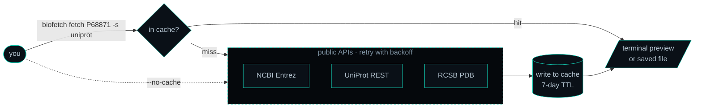
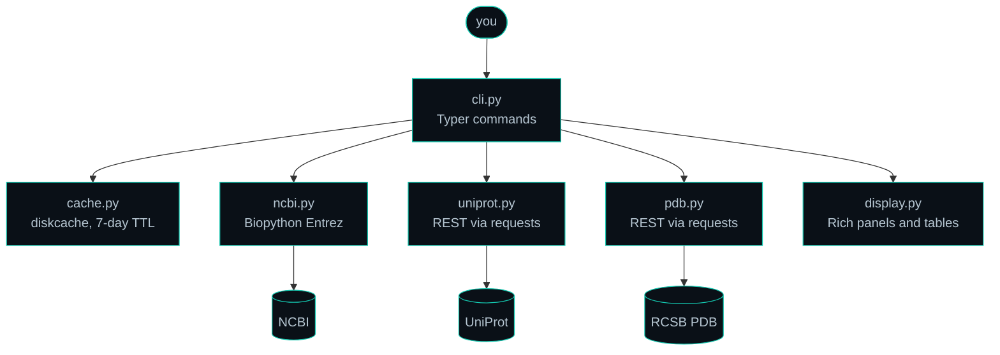

<div align="center">

<!-- visual slot: banner -->

<div align="center">
   
</div> 
<div>&nbsp;
</div> 
</div> 

 
</div> 

 


<p align="center">
  <a href="https://pypi.org/project/biofetch-cli/"></a>
  <a href="https://www.python.org/"></a>
  <a href="LICENSE"></a>
  <a href="https://github.com/Eswar-mse/biofetch/actions"></a>
  <a href="https://github.com/Eswar-mse/biofetch/commits/main"></a>
  <a href="https://github.com/Eswar-mse/biofetch/stargazers"></a>
  <a href="https://github.com/Eswar-mse/biofetch/network/members"></a>
  <a href="https://github.com/Eswar-mse/biofetch/issues"></a>
  
  
</p>


<div align="center">

<h3>DOCUMENTATION</h3>
<sub>EXPLORE BIOFETCH</sub>

<br/>

<table>
<tr>
<td align="center">
<a href="#what-is-biofetch"><code>WHAT IS BIOFETCH</code></a>
</td>
<td align="center">
<a href="#who-is-biofetch-for"><code>WHO IS BIOFETCH FOR</code></a>
</td>
<td align="center">
<a href="#how-it-works"><code>HOW IT WORKS</code></a>
</td>
</tr>
<tr>
<td align="center">
<a href="#architecture"><code>ARCHITECTURE</code></a>
</td>
<td align="center">
<a href="#installation"><code>INSTALLATION</code></a>
</td>
<td align="center">
<a href="#commands"><code>COMMANDS</code></a>
</td>
</tr>
<tr>
<td align="center">
<a href="#quickstart"><code>QUICKSTART</code></a>
</td>
<td align="center">
<a href="#formats-per-database"><code>FORMATS PER DATABASE</code></a>
</td>
<td align="center">
<a href="#the-cache"><code>THE CACHE</code></a>
</td>
</tr>
<tr>
<td align="center">
<a href="#using-biofetch-in-scripts"><code>USING BIOFETCH IN SCRIPTS</code></a>
</td>
<td align="center">
<a href="#privacy-and-network"><code>PRIVACY AND NETWORK</code></a>
</td>
<td align="center">
<a href="#limitations"><code>LIMITATIONS</code></a>
</td>
</tr>
<tr>
<td align="center">
<a href="#contributing"><code>CONTRIBUTING</code></a>
</td>
<td align="center">
<a href="#citation"><code>CITATION</code></a>
</td>
<td align="center">
<a href="#author"><code>AUTHOR</code></a>
</td>
</tr>
</table>

</div>


</div>

<div align="center">
<h3>WHAT IS BIOFETCH</h3>
</div>


Biology lives in public databases. **NCBI** holds DNA, RNA and protein sequence records, **UniProt** holds curated information about proteins, and **RCSB PDB** holds 3D structures. Each one has its own web API and its own file formats. BioFetch puts all three behind a single command, `biofetch`, so you can look a record up, read a preview in your terminal, or save it as a file, without opening a browser or learning three APIs. It also remembers what it has already downloaded, so asking for the same record twice costs nothing.

**Under the hood.** BioFetch is a Python command-line tool. [Typer](https://typer.tiangolo.com/) provides the commands and options, [Rich](https://github.com/Textualize/rich) draws the panels and tables, and NCBI is reached through Biopython's Entrez module. UniProt and RCSB PDB are reached through their public REST APIs using `requests`. Every download is stored in a local [diskcache](https://grantjenks.com/docs/diskcache/) database for seven days.


<div align="center">
<h3> WHO IS BIOFETCH FOR</h3>
</div>

- **Biologists and students** who need quick access to sequence or structure files without writing code.
- **Bioinformaticians** who want a consistent interface for scripts and pipelines, with fewer repetitive calls to public services.
- **Teachers and demonstrators** who need predictable, readable terminal output for teaching and demonstrations.

**Why BioFetch?** While `curl` is useful for one-off downloads and Biopython offers extensive programmatic control, BioFetch brings access to NCBI, UniProt, and RCSB PDB behind a single, consistent command-line interface. It combines readable terminal previews, file downloads, and local caching to make repeated retrieval simpler and more efficient.


<div align="center">
<h3> HOW IT WORKS </h3>
</div>

**In plain terms.** A **cache** is a local copy of an answer, kept so that asking the same question again does not need the internet. A **TTL** (time to live) says how long that copy is trusted before BioFetch asks the database again. BioFetch keeps copies for seven days. Public databases apply rate limits and most records change rarely, so a week-long TTL trades a little freshness for a lot of speed and good manners. **Backoff** means waiting a little longer after each failed attempt, so a busy server or a flaky connection gets time to recover.



**Under the hood.** Step by step, a `fetch` works like this:

1. Typer parses your command and options.
2. BioFetch builds a cache key of the form `source:accession:format`, for example `uniprot:P68871:fasta`, and looks it up in the local cache.
3. On a **hit** the stored text is delivered immediately. On a **miss** the matching module (`ncbi.py`, `uniprot.py` or `pdb.py`) contacts the database.
4. A successful download is stored with an expiry of 604,800 seconds, which is seven days, and then delivered.

A stored record counts as a hit while $t_{now} - t_{fetch} < 7\ \text{days}$.[^ttl]

**Retries.** Record downloads make up to **three attempts**. After the first failure BioFetch waits 1.5 seconds, after the second it waits 3 seconds, and after the third it gives up with an error message. Downloads time out after 15 seconds, or 30 seconds for PDB structure files. Searches and most metadata lookups are single attempts, with PDB entry metadata as the one exception. Because every failure is retried, even a mistyped accession takes a few seconds to be reported.

**Errors.** Any failure is caught and printed as a red `✗` line. For `fetch`, `search` and `info` BioFetch then exits with code `1`, which makes failures easy to detect in scripts. In `batch`, one failing record never stops the others, and failed records are never written to the cache.


<div align="center">
<h3>ARCHITECTURE</h3>
</div>
**In plain terms.** BioFetch is split into small parts that each do one job: one part reads your command, one part talks to each database, one part remembers answers, and one part draws the output.



**Under the hood.**

```text
biofetch/
├── biofetch/
│   ├── __init__.py    version string
│   ├── cli.py         Typer app: fetch, search, info, batch, cache, version
│   ├── cache.py       diskcache wrapper: folder, keys, 7-day TTL, stats
│   ├── ncbi.py        NCBI Entrez through Biopython
│   ├── uniprot.py     UniProt REST API: records, search, metadata
│   ├── pdb.py         RCSB PDB data, file and search APIs
│   └── display.py     Rich panels, tables, spinners and previews
├── tests.py           34 mocked tests, no network needed
├── CHANGELOG.md
├── pyproject.toml
└── .github/workflows/ci.yml
```


<div align="center">
<h3>INSTALLATION </h3>
</div>

```bash
pip install biofetch-cli
```

> [!NOTE]
> BioFetch needs **Python 3.10 or newer** and an internet connection. Its five dependencies (`biopython`, `requests`, `diskcache`, `rich` and `typer`) install automatically.

**In plain terms.** The package on PyPI is called `biofetch-cli`, but the command you type is `biofetch`. Check that it works:

```bash
biofetch version
biofetch --help
```

**Going deeper.** Install it in isolation with `pipx install biofetch-cli`, upgrade later with `pip install --upgrade biofetch-cli`, or install from source:

```bash
git clone https://github.com/Eswar-mse/biofetch.git
cd biofetch
pip install -e .
```

To uninstall, run `pip uninstall biofetch-cli`. Your cached records stay on disk until you run `biofetch cache clear` or delete the cache folder (see [the cache](#the-cache)). BioFetch is pure Python and is developed on Windows and Linux. Continuous integration runs on Linux with Python 3.10, 3.11 and 3.12, and macOS is expected to work as well.


<div align="center">

<h3>COMMANDS</h3>

A consistent command-line interface for retrieving, searching, inspecting and managing biological records.
</div>

<table>
<tr>
<td width="50%" valign="top">

<h4>Terminal Status Symbols</h4>

| Symbol | Meaning |
|:---:|---|
| <span>✓</span> | Success — fetched, cached or cleared |
| <span>✗</span> | Error — command exits with code `1` |
| <span>⚠</span> | Warning — operation continues despite a non-critical failure |
| <span>→</span> | Information — indicates where a file was saved |

Every command begins with a header panel and uses these consistent status indicators.

</td>
<td width="50%" valign="top">

<h4>Command Overview</h4>

| Command | Purpose |
|---|---|
| `fetch <ID>` | Retrieve one record |
| `search <query>` | Find records by keyword |
| `info <ID>` | Inspect metadata |
| `batch <IDs...>` | Fetch multiple records |
| `cache ...` | Manage local cache |
| `version` | Display version |


</td>
</tr>
</table>

---
<p align="center">
  <sub>QUICK NAVIGATION</sub><br/><br/>
  <a href="#fetch">FETCH</a>
  &nbsp; │ &nbsp;
  <a href="#search">SEARCH</a>
  &nbsp; │ &nbsp;
  <a href="#info">INFO</a>
  &nbsp; │ &nbsp;
  <a href="#batch">BATCH</a>
  &nbsp; │ &nbsp;
  <a href="#cache">CACHE</a>
</p>

<a id="FETCH"></a>
### `fetch` · Retrieve a record
Downloads a record using its accession ID and displays a terminal preview. Use `--output` to save the complete record.

<table>
<tr>
<td width="80%" valign="top">

| Flag | Description | Default |
|---|---|---|
| `--source` / `-s` | `ncbi`, `uniprot`, `pdb` | Required |
| `--format` / `-f` | Output format ([formats](#formats-per-database)) | `fasta` |
| `--db` | NCBI database: `nucleotide`, `protein`, `gene`, `pubmed` | `nucleotide` |
| `--output` / `-o` | Save complete record to a file | Preview |
| `--info` / `-i` | Display additional metadata | Off |
| `--preview` / `--no-preview` | Enable or disable terminal preview | On |
| `--no-cache` | Force a fresh download | Off |

</td>
<td width="35%" valign="top">

<h4>Example</h4>

```bash
biofetch fetch P68871 \
  -s uniprot \
  --info
```

**Output behaviour**

- Record preview by default.
- Complete file with `--output`.
- Additional metadata with `--info`.

</td>
</tr>
</table>

**Database-specific `--info` behaviour**

- **UniProt:** Makes an additional request and displays the UniProt Summary panel.
- **PDB:** Displays the PDB Entry Summary.
- **NCBI:** Available only with `--format fasta`. Displays sequence ID, length and GC percentage, calculated locally.

If an additional metadata lookup fails, BioFetch displays a `⚠` warning while still delivering the record.

---

<a id="SEARCH"></a>
### `search` · Find records
Searches a selected database and returns matching accessions, helping you identify records to retrieve.

<table>
<tr>
<td width="65%" valign="top">

| Flag | Description | Default |
|---|---|---|
| `--source` / `-s` | `ncbi`, `uniprot`, `pdb` | `ncbi` |
| `--db` | NCBI database: `nucleotide`, `protein`, `gene`, `pubmed` | `nucleotide` |
| `--limit` / `-n` | Maximum number of results | `10` |
| `--reviewed` | UniProt only: Swiss-Prot reviewed entries | Off |

</td>
<td width="35%" valign="top">

<h4>Example</h4>

```bash
biofetch search \
  "hemoglobin" \
  -s uniprot \
  --reviewed
```

Returns the best matching records from the selected database.

</td>
</tr>
</table>

---

<a id="INFO"></a>
### `info` · Inspect metadata
Displays a structured summary of a record without downloading its sequence.

| Database | Panel | Information provided |
|---|---|---|
| **UniProt** | UniProt Summary | Accession, entry name, protein name, gene, organism, last three taxonomy levels, length, mass, Swiss-Prot/TrEMBL status, up to 10 keywords and first function description (maximum 300 characters) |
| **PDB** | PDB Entry Summary | PDB ID, title, experimental method, resolution (Å), R-free, R-work, polymer chain count and atom count |
| **NCBI** | NCBI Record Info | All fields from NCBI's summary record, with long values truncated to 120 characters |

**Under the hood:** `info` always makes live requests and bypasses the cache. Only PDB entry metadata is retried on failure.

---

<a id="BATCH"></a>
### `batch` · Retrieve multiple records
Provide multiple accession IDs to retrieve each record and save it as an individual file in a specified directory.

During execution, BioFetch displays a live spinner with the accession being processed and elapsed time, followed by a **Batch Fetch Results** table showing each record's status (`OK` or `Failed`) and file size. A final message indicates where the files were saved.

<table>
<tr>
<td width="65%" valign="top">

| Flag | Description | Default |
|---|---|---|
| `--source` / `-s` | `ncbi`, `uniprot`, `pdb` | Required |
| `--format` / `-f` | Output format | `fasta` |
| `--db` | NCBI database | `nucleotide` |
| `--outdir` / `-d` | Output directory (created if missing) | `.` |
| `--no-cache` | Skip cache reads for all records | Off |

</td>
<td width="35%" valign="top">

<h4>Example</h4>

```bash
biofetch batch \
  P68871 P69905 \
  -s uniprot \
  -d results/
```

Each accession is saved separately in the specified directory.

</td>
</tr>
</table>

---

<a id="CACHE"></a>
### `cache` · Manage stored records
BioFetch maintains local copies of downloaded records to avoid unnecessary repeat requests.

| Command | Behaviour |
|---|---|
| `biofetch cache stats` | Displays cached entry count, cache size (KB/MB) and cache directory |
| `biofetch cache list` | Lists cached keys, e.g. `uniprot:P68871:fasta` |
| `biofetch cache delete <ID> --source <source>` | Deletes a specific entry or displays a `⚠` warning if it does not exist |
| `biofetch cache clear` | Requests confirmation before clearing the cache |

**Cache details**

- `cache delete` uses the same format as the original fetch and defaults to `fasta`. For a JSON record, specify `--format json`.
- `cache clear` requires confirmation unless `--force` / `-f` is supplied.

<div align="center">


</div>


<div align="center">
<h3> QUICK START </h3>
</div>
<!-- visual slot: demo (the one place on this page where height is welcome) -->

Three commands tell the whole story. First, find a protein:

```bash
biofetch search "hemoglobin" --source uniprot --reviewed --limit 5
```

You get a table of up to five UniProt entries with their accession, protein name, gene, organism and length. `--reviewed` keeps only manually curated Swiss-Prot entries.[^reviewed] Pick an accession, for example `P68871` (human hemoglobin subunit beta), and fetch it together with its metadata:

```bash
biofetch fetch P68871 --source uniprot --info
```

BioFetch prints a status line, a preview of the first lines of the FASTA record, and a UniProt Summary panel with the entry name, gene, organism, length, mass, keywords and function. Run the same command once more:

```bash
biofetch fetch P68871 --source uniprot
```

This time the status line says the record was **served from cache**. No network request was made for the sequence.

> [!TIP]
> To keep the whole record rather than a preview, add `--output P68871.fasta`. The terminal shows a preview only, by design, so a huge record never floods your screen.

**More recipes.**

```bash
# Fetch a nucleotide sequence from NCBI
biofetch fetch NM_001301717 --source ncbi

# Fetch a protein record from NCBI (note --db protein)
biofetch fetch NP_000509 --source ncbi --db protein

# Fetch a PDB structure as a .pdb file
biofetch fetch 1HHO --source pdb --format pdb --output 1HHO.pdb

# Search the NCBI nucleotide database
biofetch search "BRCA1 human mRNA" --source ncbi --db nucleotide --limit 10

# Search PDB for insulin structures
biofetch search "insulin" --source pdb --limit 5

# Rich metadata for a UniProt entry, and a PDB entry summary
biofetch info P68871 --source uniprot
biofetch info 1HHO --source pdb

# Batch fetch several UniProt accessions into a folder
biofetch batch P68871 P69905 P68873 --source uniprot --outdir ./sequences

# Batch fetch NCBI records
biofetch batch NM_001301717 NM_000546 --source ncbi --db nucleotide --outdir ./data
```


<div align="center">
<h3> FORMATS PER DATABASE </h3>
</div>
<a id="formats-per-database"></a>

**In plain terms.** A *format* is how a record is written down. Some formats are just the sequence, others add annotations, and others describe 3D coordinates. The same `--format` flag is shared by all databases, but each database only supports its own set:

| Database | `--format` values | Notes |
| :--- | :--- | :--- |
| **NCBI** | `fasta` (default), `genbank` (or `gb`), `xml`, `text` | `genbank` adds features and annotations to the sequence |
| **UniProt** | `fasta` (default), `json`, `txt`, `xml`, `tsv` | `txt` is UniProt's classic flat-file format, `tsv` suits spreadsheets |
| **RCSB PDB** | `fasta`, `pdb`, `cif` | `fasta` is the default and gives the *sequences* of the entry. For atomic coordinates ask for `pdb` or `cif` |

**Which one should I use?**

- **FASTA** is the plain sequence with a single header line. Choose it for alignments, BLAST and most sequence tools.
- **GenBank** is the sequence plus its annotations, such as genes, coding regions, the source organism and references. Choose it when you need to know what the sequence *contains*.
- **JSON** and **XML** are structured and machine-readable. Choose them when a script or program will read the record.
- **TSV** is a tab-separated table. Choose it to open a UniProt record in a spreadsheet.
- **PDB** and **mmCIF** hold the 3D coordinates of every atom, and tools such as PyMOL and ChimeraX open both. mmCIF is the newer, extensible format, and some very large structures are only available as mmCIF.

> [!WARNING]
> BioFetch does not validate `--format` against the database. An unsupported value quietly falls back instead of failing: NCBI and UniProt return FASTA, and PDB returns mmCIF. The record is then cached under the format name you typed. If something looks wrong, compare your value with the table above.


<div align="center">
<h3> THE CACHE </h3>
</div>
<a id="the-cache"></a>

**In plain terms.** The first time you fetch a record, BioFetch keeps a copy in a folder on your computer. Next time it reads that copy instead of using the internet, which is instant and spares the public databases.

**Where it lives.**

| System | Location |
| :--- | :--- |
| **Windows** | `%LOCALAPPDATA%\biofetch\` |
| **Linux and macOS** | `$XDG_CACHE_HOME/biofetch/`, which is `~/.cache/biofetch/` when that variable is not set |

**Under the hood.** The folder is a [diskcache](https://grantjenks.com/docs/diskcache/) database, which is built on SQLite and is designed to be used safely by several processes at once, so running two BioFetch commands in parallel is fine. Each entry is keyed `source:accession:format` and expires after seven days. The expiry is fixed in the current version and is not a command-line option. If the folder is ever damaged, deleting it is safe, because it only holds copies of public data.

> [!IMPORTANT]
> Cached records are served for up to **7 days**. If a record changes upstream in that window, pass `--no-cache` or run `biofetch cache delete` to see the change.

> [!WARNING]
> `biofetch cache clear` deletes **every** cached record. It asks for confirmation first, unless you pass `--force`.

> [!CAUTION]
> NCBI, UniProt and RCSB PDB are free public services. Avoid hammering them in tight loops with `--no-cache`.


<div align="center">
<h3>USING BIOFETCH IN SCRIPTS </h3>
</div>

**In plain terms.** BioFetch works well inside shell scripts and pipelines, as long as you remember two things: use `--output` to get the full record, and check the exit code.

```bash
# Save one record, and only continue if it worked
biofetch fetch P68871 --source uniprot --output P68871.fasta && echo "saved"

# Fetch every accession listed in a file (one per line)
biofetch batch $(cat accessions.txt) --source uniprot --outdir ./sequences
```

```powershell
# The same batch in PowerShell
biofetch batch (Get-Content accessions.txt) --source uniprot --outdir .\sequences
```

**Under the hood.** `fetch`, `search` and `info` exit with `1` on failure, and a missing required option exits with `2`. `batch` always exits with `0`, so inspect its summary table or the output folder to see which records failed. Re-running a batch is cheap, because everything that succeeded is already cached and only the failures reach the network again. Output is meant for people, with colours and panels, so for programmatic use rely on the saved files instead of parsing the terminal text.


<div align="center">
<h3> PRIVACY AND NETWORK </h3>
</div>

BioFetch has no server, account, API key or telemetry of its own. The only network traffic is between your computer and NCBI, UniProt and RCSB PDB, and what is sent is just the accession or search query you typed. Cached records are plain copies of public data stored in your user cache folder. NCBI is contacted through Biopython and UniProt and PDB through `requests`, so if you work behind a proxy, set the usual `HTTP_PROXY` and `HTTPS_PROXY` environment variables.


<div align="center">
<h3> LIMITATIONS</h3>
</div>
Knowing these up front saves surprises:

- `fetch` prints a **preview** only. Use `--output` to keep the full record.
- The cache lifetime is fixed at **7 days** and cannot be changed from the command line.
- NCBI search shows Entrez IDs only, and PDB search shows IDs and scores only. Use `info` to learn more about a hit.
- Searches and `info` lookups are **not cached**.
- BioFetch uses a generic contact address for NCBI Entrez and does not use an NCBI API key, so NCBI's default request limit of about three requests per second applies.
- `batch` is sequential and has no built-in delay between records. It relies on retries when a service pushes back.
- Only text formats are supported.


<div align="center">
<h3>CONTRIBUTING</h3>
</div>

Found a bug or have an idea? [Open an issue](https://github.com/Eswar-mse/biofetch/issues). Pull requests are welcome, see [CONTRIBUTING.md](CONTRIBUTING.md) first.

To work on the code:

```bash
git clone https://github.com/Eswar-mse/biofetch.git
cd biofetch
pip install -e .
python tests.py
```

The test suite uses mocked API responses, so it runs offline in a few seconds. Each test is a small function registered with the `@test("name")` decorator, so adding one is a matter of copying an existing pattern. GitHub Actions runs the same file on every push and pull request.


<div align="center">
<h3> CITATION</h3>
</div>

If BioFetch helps your research, please cite it:

```bibtex
@software{moparti_biofetch,
  author  = {Moparti, Sri Venkata Satya Sai Eswar},
  title   = {BioFetch: unified NCBI, UniProt and PDB command-line fetcher with local caching},
  year    = {2025},
  url     = {https://github.com/Eswar-mse/biofetch},
  version = {1.0.2}
}
```


<div align="center">
<h3>AUTHOR</h3>
</div>

**Sri Venkata Satya Sai Eswar Moparti**, author and maintainer of biofetch.<br>
[Portfolio](https://eswar-mse.github.io) · [ORCID 0009-0005-4635-7368](https://orcid.org/0009-0005-4635-7368) · [GitHub @Eswar-mse](https://github.com/Eswar-mse)

If BioFetch saves you time, a :star: on GitHub helps other researchers find it. Released under the [MIT license](LICENSE).


[^reviewed]: "Reviewed" means UniProtKB/Swiss-Prot, the manually annotated and curated part of UniProt. The rest, TrEMBL, is annotated automatically.
[^ttl]: Entries are stored through [`diskcache`](https://grantjenks.com/docs/diskcache/) with a 7-day expiry.
[^uid]: A UID is the numeric identifier Entrez uses internally for each record. It is different from the accession string, but both can be passed to `fetch`.
